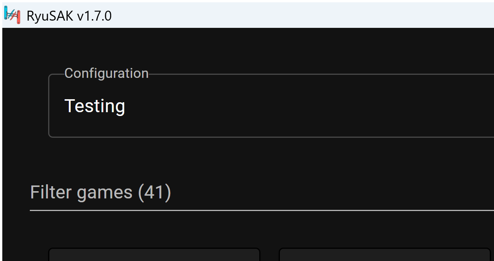

# RyuSAK Community Build


<p align="center">
  
</p>

This is a community-maintained fork of the original [Ecks1337/RyuSAK](https://github.com/Ecks1337/RyuSAK) project.

In an effort to keep Nintendo from fondling my booty cheeks. Product keys and firmware download/install functionality have been removed from this community build.

## Installation
Download RyuSAK from the [v1.8.0 release](https://github.com/Casual-Gamer8001/RyuSAK/releases/tag/v1.8.0).

### Windows
Download `RyuSAK-1.8.0-Setup.exe`. The setup wizard asks whether you want a standard install or a portable install before you choose the install folder.

#### Standard install
Choose **Standard install** in setup to store RyuSAK settings in your Windows user profile.

#### Portable
Choose **Portable install** in setup to create the `portable` marker and keep settings in an `electron_cache` folder next to `RyuSAK.exe`.

### Steam Deck / SteamOS
Download `RyuSAK-1.8.0-steamdeck-linux-x64.zip` on the Steam Deck.

1. Switch to **Desktop Mode**.
2. Extract the ZIP file.
3. Open the extracted `RyuSAK-linux-x64` folder.
4. Run `RyuSAK`.
5. If SteamOS blocks launch, right-click `RyuSAK`, open **Properties**, and allow it to execute as a program.
6. In RyuSAK, use **Configuration** to select your Ryujinx/Ryubing data folder.

Common Flatpak data paths are:

```text
~/.var/app/org.ryujinx.Ryujinx/config/Ryujinx
~/.var/app/org.ryubing.Ryubing/config/Ryujinx
~/.var/app/org.ryubing.Ryubing/config/Ryubing
```

#### Add RyuSAK to Gaming Mode
1. In Desktop Mode, open Steam.
2. Go to **Games > Add a Non-Steam Game to My Library**.
3. Click **Browse** and select the extracted `RyuSAK-linux-x64/RyuSAK` executable.
4. Add it to your library.
5. Right-click the new RyuSAK entry, open **Properties**, and set launch options to:

```text
--no-sandbox
```

6. Return to Gaming Mode and launch RyuSAK from your Steam library.

### macOS (Apple Silicon)
Download `RyuSAK-1.8.0-arm64.dmg` on an Apple Silicon (M1 or newer) Mac.

1. Open the `.dmg` and drag **RyuSAK** to your **Applications** folder.
2. This community build is not signed with an Apple Developer certificate, so the first launch is blocked by Gatekeeper. To open it, **right-click (or Control-click) RyuSAK in Applications and choose Open**, then confirm **Open** in the dialog. You only need to do this once.
   - If macOS still refuses, run `xattr -cr /Applications/RyuSAK.app` in Terminal to clear the download quarantine, then open it normally.
3. In RyuSAK, use **Configuration** to select your Ryujinx/Ryubing data folder.

## Features
* Add one or multiple Ryujinx/Ryubing data folders to manage different emulator installs
* Manage Eden and Eglantine libraries next to Ryujinx/Ryubing, using the emulator tabs at the top
* List your game library
* Download, share, and merge shader caches through the community backend
* Build a game's shaders from your own game files, so Ryubing compiles far fewer shaders while you play
* Use shader cache variant metadata when different Ryujinx/Ryubing cache formats are available
* Set custom game titles and covers
* Hide duplicates/unknowns from the RyuSAK library
* Show Ryubing compatibility data
* Install supported GameBanana mods directly into the emulator mods folder
* Get clear manual-install guidance when a GameBanana mod cannot be safely installed automatically
* Adjust game icon size with a polished live slider using friendly size labels
* Update in place from within the app. Downloads are checked against the release's SHA-256 before anything is installed. On Windows a small update helper takes over while RyuSAK is closed: it backs up the install, runs the silent installer with a progress window, and restores the previous version if anything fails. Linux and Steam Deck apply the update the same way, with a full rollback, and relaunch automatically
* Run on Steam Deck/SteamOS using the Linux x64 test package

## Eden and Eglantine
RyuSAK can also manage [Eden](https://git.eden-emu.dev/eden-emu/eden) and [Eglantine](https://github.com/Djihads80/Eglantine). Use the **Ryujinx**, **Eden** and **Eglantine** tabs at the top to switch emulators. Each one keeps its own list of configurations.

* Games show up with the names and icons that Eden or Eglantine saved in their game list cache, so open the emulator once and let it load your game folders first.
* For a portable install, choose **Configuration > Add additional configuration** and select the emulator program (`eden.exe` or `eglantine.exe`, the AppImage, or the `.app`). If a `user` folder sits next to it, RyuSAK uses that folder.
* GameBanana mods are installed into the emulator's `load/<title ID>` folder.
* Shader download and sharing work with Ryujinx/Ryubing only for now. The shader cache and mods buttons still open the right folders for Eden and Eglantine.
* Eden 0.2.1 and older keep shader caches in the `shader` folder, while newer Eden builds and Eglantine use `cache/shader`. RyuSAK checks both.
* Eden and Eglantine use the same standard data folder (`%APPDATA%\eden` on Windows, `~/.local/share/eden` on Linux and macOS). Their shader cache formats are different, so if you play the same game in both from that folder they keep deleting each other's cache. Using a portable install for one of them avoids that.

## Building shaders from game files
Switch games ship their shaders compiled for the console's GPU, so Ryubing has to translate each one the first time the game uses it, which causes stutter. On a game's page, **Build shaders** reads the shader programs inside your own copy of the game (using the keys and game folders you set up in Ryubing) and adds them to Ryubing's shader cache ahead of time.

* Start the game once in Ryubing (until the title screen) before building. RyuSAK learns the game's graphics settings from the shaders Ryubing saved on that first run. Building again later, after playing more, adds anything it missed.
* Close Ryubing while building. The next time the game starts, Ryubing prepares the new shaders once, which can take a few minutes. After that, start-up is quick again.
* Ryubing keeps every cached shader in memory, so a bigger cache uses more RAM. When a game includes material information RyuSAK understands, it builds only the shaders those materials and your own play history indicate are likely to be used, up to a limit based on how much RAM your computer has. Games without that information keep the broader fallback.
* **Remove built shaders** takes out only what RyuSAK added and keeps the shaders Ryubing compiled while you played. A backup of the cache is also kept in the game's `cache/ryusak-shader-backups` folder.
* Built shaders stay on your computer: they are left out when you share shaders, and nothing is downloaded or uploaded while building.
* This works with Ryubing's shader cache format only. If a future Ryubing version changes that format, RyuSAK refuses to change the cache until it is updated.

In our test with Super Mario Odyssey, starting from a fresh player's cache, building added about 20,600 shaders. Ryubing then compiled 4 new shaders during the opening scenes instead of 99.

The builder is a small .NET program in `shaderbuilder/`. It uses Ryubing's own shader translator (MIT licensed, see `shaderbuilder/ryubing/SOURCE.md`) to check each shader exactly the way Ryubing would.

## Reporting issues & test results
This is a community-driven fork, so anyone can help. Every report stays verifiable because the templates ask for the exact version, platform, and logs.

Open an issue from the [**New issue**](https://github.com/Casual-Gamer8001/RyuSAK/issues/new/choose) page and pick a template:

- **Bug report** when something is broken or behaving incorrectly.
- **Build test report** when you've installed a build and want to tell us whether it works on your hardware. This is especially valuable for **macOS** and **Steam Deck**, which the maintainers may not be able to test directly, and it's how we confirm a build is good before promoting it to a full release.
- **Defective shader cache report** when a shader cache you downloaded is broken or does not help a specific game. Reports include the game's **Title ID**, which lets a maintainer deterministically verify the published cache (corrupt, incomplete, wrong shader count, or an outdated shader codegen), and anyone can reproduce that read-only check.
- **Feature request** for an idea or improvement.

For general questions or help, use the [Discord](https://discord.gg/kKKFmnaZyc) instead of opening an issue.

### Update logs
If an in-app update fails, attach its logs. Each update keeps them in its own folder:

- **Windows (standard install):** `%LOCALAPPDATA%\RyuSAK\updates\<version>\`
- **Portable installs, Linux and Steam Deck:** `electron_cache/updates/<version>/` next to RyuSAK

`update-bootstrap.log` covers the download and verification, `apply-update.log` covers installing (and any rollback), and `installer.log` is the Windows setup log.

## Contributing
Requirements:
* Node.js
* Git
* .NET 10 SDK (for the shader builder)

Install dependencies: `npm install --include=dev`

Run local build: `npm start` (run `node scripts/build-shader-builder.js` once first, so the shader builder is available)

Package a Windows build: `npm run build` (this also publishes the shader builder in `shaderbuilder/` with the .NET SDK, and compiles the Windows update helper in `updater/windows` with the .NET Framework 4 C# compiler that comes with Windows)

## Credits
* Ecks1337 and contributors for the original RyuSAK project
* CapitaineJSparrow for creating the original [emusak-ui](https://github.com/CapitaineJSparrow/emusak-ui) project
